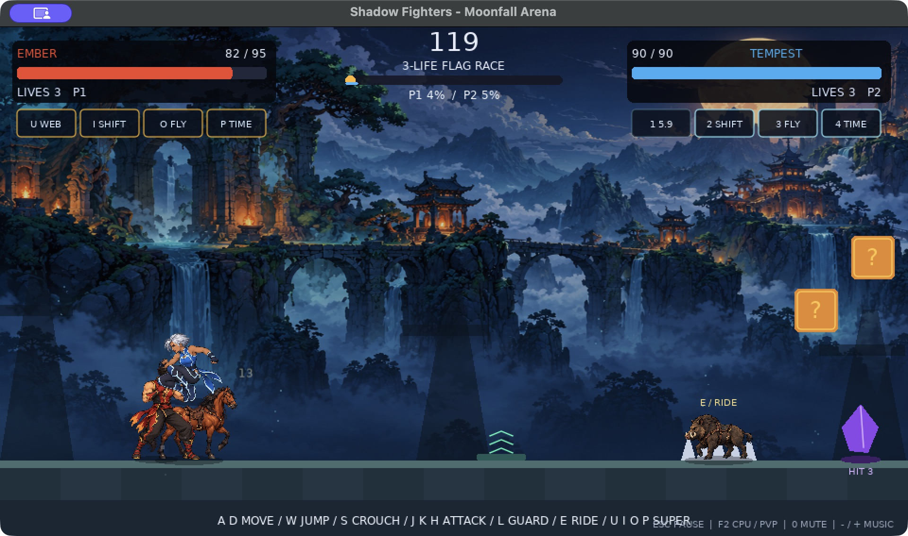

# Shadow Fighters — Moonfall Arena

Play: open `dist/Shadow Fighters - Moonfall Arena.app` on this Mac. The bundled LÖVE 11.5 runtime means no separate install is needed. `dist/Moonfall-Arena.love` is also available for other machines with LÖVE 11.5.

## Controls
A/D move; W jump; S crouch; J high strike; K middle strike; H low kick; L guard; E mount/dismount. U web swing; I teleport; O flight; P time stop. R restart; C character selection; Esc pause/resume; F11 fullscreen. F2 CPU/PvP. 0 mute/unmute; minus/equal music volume; brackets effect volume. The M key remains player 2's mid attack.

CPU opponent is enabled by default. Confirm a fighter with Enter. For keyboard PvP use F2; player 2 confirms with N. Three lives and checkpoints; reach the flag or defeat the opponent.

## Added in this build
- Four illustrated fighters, 40 pose images across combat/walk/guard/riding atlases, matching selection portraits. Two-stride walking cycle, pose-based attacks, crouching, aerial and hit reactions.
- Moonlit ruins panorama with parallax columns and animated drifting motes. Illustrated horse and boar.
- Spring pads, updrafts, three-hit crystals (+18 HP and -4 sec super cooldowns), shield altar (18 sec cooldown). Existing moving platforms, pits, spikes and contested power-ups retained.
- Colored impact particles, damage labels, guard arcs, strike trails, super bursts, time-stop clock aura, landing dust.
- 17 original synthesized sound effects and two looping original BGM tracks, crossfades, super-time music ducking, music/effects volume controls and mute. Audio is included in the app and works offline.
- Readable compact HUD, pause screen, CPU hazard anticipation, fixed forced-PvP behavior when no phone is connected.

## Development
Based on upstream 1275621, branch feature/illustrated-arena. Shared from the `feature/illustrated-arena` branch for upstream review. Main gameplay remains in main.lua; new presentation, sound and stage objects in arena_fx.lua.
Run `love . --selftest` for combat/guard/supers/stage/cooldown/reset/pause/CPU/render integration checks. Native launch and CPU combat also checked.
Art generated using built-in image_gen; prompts in ART_PROMPTS.json. Source PNGs are preserved; atlas.lua/json only describe alpha-measured frame bounds and pivots. Generation scripts in tools/. Audio generation needs NumPy; atlas measurement needs Pillow.
Phone controller source is retained. For packaged play, run controller_server.py from the app's Contents/Resources directory, then use the printed LAN URL. Phone-controller live pairing has not been retested in this build.

## Current limits
This is a playable art-and-sound prototype, not a polished commercial release. Walking uses two poses and combat uses pose transitions, not high-frame-count traditional animation. Animals use illustrated standing sprites with motion bobbing. Audio is original synthesis, not recorded Foley or orchestral recordings. Mac app uses local ad-hoc signing; it is not Apple-notarized for public distribution.

## Run this branch
Clone/check out this branch, install LÖVE 11.5, then run `love .`. All generated art and audio files are committed; no API keys or asset generation are needed to play. For Mac packaging: `python3 tools/build_mac.py /path/to/love.app`.

